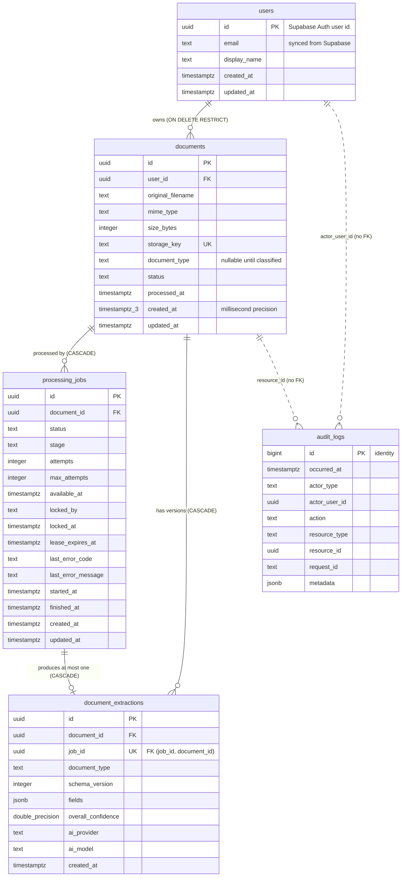

# Database schema

PostgreSQL 17 is the system of record (ADR-002) and the job queue (ADR-005). Data access uses
Kysely with hand-written SQL migrations (ADR-012).

- Migration: `apps/api/src/database/migrations/20261029120000_initial_schema.ts`
- Generated row types: `apps/api/src/database/generated/database.ts` (`npm run db:codegen`)
- Repositories: `apps/api/src/{users,documents,jobs,extraction,audit}/*.repository.ts`

## Entity relationship diagram



## Conventions

| Convention                                      | Reason                                                                                                                                                                                              |
| ----------------------------------------------- | --------------------------------------------------------------------------------------------------------------------------------------------------------------------------------------------------- |
| `uuid` keys from `gen_random_uuid()`            | Ids appear in URLs; random UUIDs are not guessable or enumerable, unlike sequential integers. `audit_logs` uses `bigint` identity instead: never exposed by id, append-only, and naturally ordered. |
| Status columns are `text` + `CHECK`, not `ENUM` | Postgres enum values can be added but not removed or renamed, and a new value cannot be used in the transaction that adds it. A `CHECK` is replaced in one migration.                               |
| Allowed values are literals in the migration    | A migration is a frozen snapshot. A test (`migrations.integration.spec.ts`) fails if the literals and the shared constants in `packages/shared` disagree.                                           |
| `timestamptz` everywhere                        | Stores an absolute instant; avoids timezone ambiguity.                                                                                                                                              |
| `updated_at` maintained by trigger              | Correct no matter which code path writes the row.                                                                                                                                                   |
| Length `CHECK`s on free text                    | Bounds storage abuse and keeps unbounded input out of indexes.                                                                                                                                      |
| Explicit constraint names                       | Tests and error handling refer to constraints by name.                                                                                                                                              |

## Tables

### users

**Why it exists.** Documents and audit entries need a local owner to reference. Identity itself
(passwords, sessions, verification) belongs to Supabase Auth (ADR-013), so this table
stores no credentials. `id` is the Supabase user id (JWT `sub`) and therefore has no default.
There is deliberately no foreign key into Supabase's `auth` schema, so local Docker databases and
tests work without Supabase.

**Queries.** Lookup by primary key on every authenticated request; on first sight
`INSERT … ON CONFLICT (id) DO NOTHING`; `UPDATE` of email/display name only when Supabase reports
a change, so an unchanged user costs one read and no write.

**Indexes.** Primary key only. Email is deliberately not unique: the row is a lazily synced copy
of the Supabase identity and can hold a stale email after an email change or account deletion,
which must not block a legitimate new user (migration `20261029140000_users_email_not_unique`;
see [authentication](../security/authentication.md#user-provisioning)).

**Concurrency.** Two first requests for the same new user both run the insert; the second waits on
the primary key, then skips. Exactly one row and one `user.registered` audit entry result (tested
over HTTP with 8 concurrent requests).

**Retention.** Account deletion must first delete the user's documents and stored objects
(`ON DELETE RESTRICT` from `documents` enforces the order). Audit entries keep the user id.

### documents

**Why it exists.** Metadata for an uploaded file. The bytes live in object storage under
`storage_key` (ADR-003), always `documents/{userId}/{year}/{documentId}/original.{ext}` (see
[storage/document-uploads.md](../storage/document-uploads.md#storage-keys)).

**Relationships.** Many per user. Deleting a user is blocked while documents exist (`RESTRICT`), so
storage objects can never be orphaned by a cascading delete that storage does not know about.

**Status model.** `documents.status` is the coarse, user-facing lifecycle (`uploaded`, `queued`,
`processing`, `needs_review`, `completed`, `failed`). Fine-grained pipeline progress (OCR,
classification, …) lives on `processing_jobs.stage`. `processed_at` is set exactly when the status
is an outcome (`needs_review`, `completed`, `failed`), enforced by a `CHECK`.

**Queries.**

| Query                                | Shape                                                                                            | Index                                 | Cost                                         |
| ------------------------------------ | ------------------------------------------------------------------------------------------------ | ------------------------------------- | -------------------------------------------- |
| Owner's list, newest first           | `WHERE user_id = $1 AND (created_at, id) < ($2, $3) ORDER BY created_at DESC, id DESC LIMIT n+1` | `documents_user_id_created_at_id_idx` | Index range scan, no sort; constant per page |
| One document                         | `WHERE id = $1 AND user_id = $2`                                                                 | Primary key                           | One row                                      |
| Owner's list, oldest first           | Same, `>` and `ORDER BY created_at, id`                                                          | `documents_user_id_created_at_id_idx` | Backward index scan, no sort                 |
| Owner's list by name or size         | `WHERE user_id = $1 AND (sort_col, id) > ($2, $3) ORDER BY sort_col, id LIMIT n+1`               | Any `user_id`-prefixed index          | Sorts the owner's matching rows (no index)   |
| Filename search                      | `… AND original_filename ILIKE '%term%'` (wildcards escaped)                                     | Any `user_id`-prefixed index          | Scans the owner's rows; trigram index later  |
| Status filters/counts (Phases 5, 12) | `WHERE user_id = $1 AND status = $2`                                                             | `documents_user_id_status_idx`        | Index scan                                   |
| Delete                               | `DELETE … WHERE id = $1 AND user_id = $2 RETURNING *`                                            | Primary key                           | One row + cascades                           |

**Pagination.** Keyset (cursor) pagination rather than `OFFSET`: `OFFSET n` reads and discards
`n` rows, so late pages get slower, and rows inserted between requests shift page boundaries
(duplicates or gaps). The `(created_at, id)` row comparison uses the index directly in both
directions (verified with `EXPLAIN` on 5,000 rows: the comparison is the index condition, "oldest"
is an `Index Scan Backward`, and neither sorts). Name and size orders filter the owner's rows
through a `user_id`-prefixed index, then sort them. `id` breaks ties between
equal timestamps. Every sort order uses the same pattern with its own column; names compare
under the ICU root collation so the order does not depend on the server's C library (see
[document-management.md](../documents/document-management.md#sorting-and-keyset-pagination)).
`created_at` is `timestamptz(3)` because the cursor round-trips through a
JavaScript `Date`, which has millisecond precision; with microsecond precision the cursor would not
match the stored value exactly.

**Authorization (IDOR).** Every repository read and delete takes the owner id and filters on it in
SQL. There is no "find by id" without an owner.

### processing_jobs

**Why it exists.** It is the durable queue (ADR-005) and the job history shown in the Processing
UI. Behavior (claiming, leases, retries, completion) is built in Phase 9; this phase defines the
schema that makes that behavior safe.

**State.** `status`: `queued → running → succeeded | failed`. A retryable failure returns the job to
`queued` with a later `available_at` (backoff) and incremented `attempts`. `failed` is terminal (the
dead-letter state); `last_error_code`/`last_error_message` (capped at 2,000 characters) keep the
reason.

**Invariants enforced by the database.**

| Constraint                                                                                                     | Guarantees                                                                                           |
| -------------------------------------------------------------------------------------------------------------- | ---------------------------------------------------------------------------------------------------- |
| `processing_jobs_one_active_per_document_key` (partial unique on `document_id` where status is queued/running) | At most one active job per document, even under concurrent or duplicate enqueue requests             |
| `processing_jobs_attempts_within_max`                                                                          | `attempts <= max_attempts`                                                                           |
| `processing_jobs_lease_matches_status`                                                                         | A running job always has an owner and an unexpired-at-claim lease; a non-running job never holds one |
| `processing_jobs_finished_at_matches_status`                                                                   | `finished_at` is set exactly for finished jobs                                                       |
| `processing_jobs_id_document_id_key`                                                                           | Target for the composite FK from `document_extractions`                                              |

**Queries and indexes.**

| Query (phase)                                                                                                                | Index                                                          |
| ---------------------------------------------------------------------------------------------------------------------------- | -------------------------------------------------------------- |
| Claim next job: `WHERE status = 'queued' AND available_at <= now() ORDER BY available_at LIMIT 1 FOR UPDATE SKIP LOCKED` (9) | `processing_jobs_claimable_idx` (partial, `status = 'queued'`) |
| Recover stale jobs: `WHERE status = 'running' AND lease_expires_at < now()` (9)                                              | `processing_jobs_running_lease_idx` (partial)                  |
| Active job for a document (1)                                                                                                | `processing_jobs_one_active_per_document_key`                  |
| A document's job history; FK cascade from `documents` (5)                                                                    | `processing_jobs_document_id_created_at_idx`                   |

Partial indexes stay small: finished jobs, which are the large majority over time, are not in the
claim or lease indexes at all.

**Concurrency.**

- _Duplicate enqueue:_ `INSERT … ON CONFLICT (document_id) WHERE status IN ('queued','running')
DO NOTHING`. The partial unique index is the arbiter; ten concurrent enqueues produce exactly one
  job (tested). A narrow race (the conflicting job finishes before it can be read back) is handled
  by retrying the insert.
- _Multiple workers (Phase 9):_ `FOR UPDATE SKIP LOCKED` lets each worker lock a different queued
  row without waiting on rows other workers hold.
- _Worker crash (Phase 9):_ the claim sets `lease_expires_at`; a running job whose lease expired
  is returned to the queue by stale-job recovery.
- _Pooler compatibility:_ all of this uses row locks inside a transaction, which work through
  Supabase's transaction-mode pooler. Session-level advisory locks would not.

**Retention.** Rows are deleted with their document. Job history otherwise grows; Phase 15 should
consider pruning or archiving finished jobs.

### document_extractions

**Why it exists.** Structured AI output after schema validation (Phase 8). Each successful job
produces one immutable version; reprocessing adds a new version rather than overwriting. Review
edits (Phase 10) will be stored separately so the original model output stays auditable.

**Invariants.**

- `UNIQUE (job_id)`: a job stores at most one extraction. If the worker crashes after inserting but
  before marking the job succeeded, the retried insert returns the stored row instead of a duplicate
  (`insertOnce`, tested).
- Composite FK `(job_id, document_id) → processing_jobs (id, document_id)`: the job must belong to
  the same document. A plain FK on `job_id` could not express this.
- `fields` must be a JSON object; `overall_confidence` must be within `[0, 1]`.
- `ai_provider`/`ai_model`/`schema_version` record provenance, so a result can be traced to the
  model and schema that produced it.

**Queries.** Latest for a document: `WHERE document_id = $1 ORDER BY created_at DESC, id DESC
LIMIT 1` → `document_extractions_document_id_created_at_id_idx` (no sort step, verified).

**Why `jsonb`.** The three document types have different fields, and field-level values carry
confidence. A table per type, or an entity-attribute-value table, would add joins without adding
integrity the application's Zod validation does not already provide. The trade-off: the database
cannot validate the inner shape, so invalid output must be rejected before insert (Phase 8).

### audit_logs

**Why it exists.** An append-only record of security-relevant and user-visible actions (Phase 11).

**Design.**

- `actor_user_id` and `resource_id` have **no foreign keys**, so history survives deletion of the
  user or the resource. That is the point of an audit log.
- A `BEFORE UPDATE` trigger rejects every update (`restrict_violation`). `DELETE` stays allowed so
  retention can purge old entries.
- `action` must look like `resource.verb` (for example `document.uploaded`); `actor_type` and
  `actor_user_id` must agree.
- `metadata` must never contain secrets, tokens or document content (application rule, documented on
  the repository).
- Actions written so far: `user.registered`, `document.uploaded`, `document.deleted`,
  `document.viewed` and `document.downloaded` (each file access, recorded before the first byte is
  sent). Document entries carry only the MIME type and size, never the filename.

**Queries.** A resource's timeline → `audit_logs_resource_occurred_at_id_idx`; a user's activity →
`audit_logs_actor_user_id_occurred_at_idx` (partial: system actions excluded).

**Retention.** This is the fastest-growing table. Phase 15 should evaluate time-based partitioning
(monthly), which turns retention purges into cheap partition drops.

## Transactions

Repository methods accept an optional executor, so a caller can run several of them in one
transaction:

```ts
await db.transaction().execute(async (trx) => {
  await documents.create(newDocument, trx);
  await jobs.enqueue(newDocument.id, trx);
});
```

| Operation (phase)                                                     | Transaction? | Why                                                                                                    |
| --------------------------------------------------------------------- | ------------ | ------------------------------------------------------------------------------------------------------ |
| Create document + enqueue job (4, 9)                                  | Yes          | Both or neither. This is what removes the dual-write problem (ADR-005). Tested with a forced rollback. |
| Store extraction + mark job succeeded + update document status (8, 9) | Yes          | A crash in between must not leave a succeeded job without its extraction, or the reverse.              |
| Single-statement upserts and deletes                                  | No           | One statement is already atomic.                                                                       |
| Provision user + `user.registered` audit entry (2)                    | Yes          | The audit trail must record every account the system created, and only those.                          |
| Readiness check                                                       | No           | Read-only `SELECT 1`.                                                                                  |

Isolation level: Postgres's default `READ COMMITTED`. The invariants above rely on unique
constraints and row locks rather than on higher isolation levels.

## Operational settings

Configured per process in `apps/api/src/database/create-database.ts`:

| Setting                               | Value                                          | Reason                                                                                                                                |
| ------------------------------------- | ---------------------------------------------- | ------------------------------------------------------------------------------------------------------------------------------------- |
| `max` connections                     | `DATABASE_POOL_MAX` (default 10)               | The API and the worker each have a pool; the sum must stay under the server's connection limit.                                       |
| `statement_timeout`                   | `DATABASE_STATEMENT_TIMEOUT_MS` (default 30 s) | A runaway query cannot hold a connection forever.                                                                                     |
| `idle_in_transaction_session_timeout` | 60 s                                           | A transaction left open by a bug cannot hold row locks indefinitely.                                                                  |
| `application_name`                    | `documind-api`, `documind-worker`, …           | Identifies each process in `pg_stat_activity`.                                                                                        |
| Pool `error` listener                 | logs                                           | An idle connection dropped by the server (for example on a restart) would otherwise crash the process. Verified by stopping Postgres. |

Not verified yet: whether Supabase's transaction-mode pooler honours the timeout startup parameters.
Check in Phase 16.

## Seed data

`npm run db:seed` inserts a demo user (`demo@documind.local`, id
`00000000-0000-4000-8000-000000000001`) with three documents (completed invoice with extraction,
queued contract, failed purchase order), their jobs and audit entries.

- Idempotent: fixed ids with `ON CONFLICT DO NOTHING`.
- Refused when `NODE_ENV=production`.
- Synthetic: the seed's storage keys point at no real objects, and the demo user can only sign in
  once a Supabase user with the same id exists (Phase 2).

Tests never use the seed; each test builds the rows it needs (`apps/api/test/support/factories.ts`).

## Migration workflow

1. Add `apps/api/src/database/migrations/<UTC yyyymmddhhmmss>_<name>.ts` with `up` and `down`.
2. Register it in `migrations/index.ts` (a unit test fails if a file is not registered).
3. `npm run db:migrate`, then `npm run db:codegen` to regenerate the row types, and commit both.
4. `npm run db:codegen:check` verifies the generated types match the database.

Rules: never edit a migration that has been applied outside a developer's machine; write a new one.
`down` exists for local development and is not a production rollback strategy; production fixes
roll forward.
