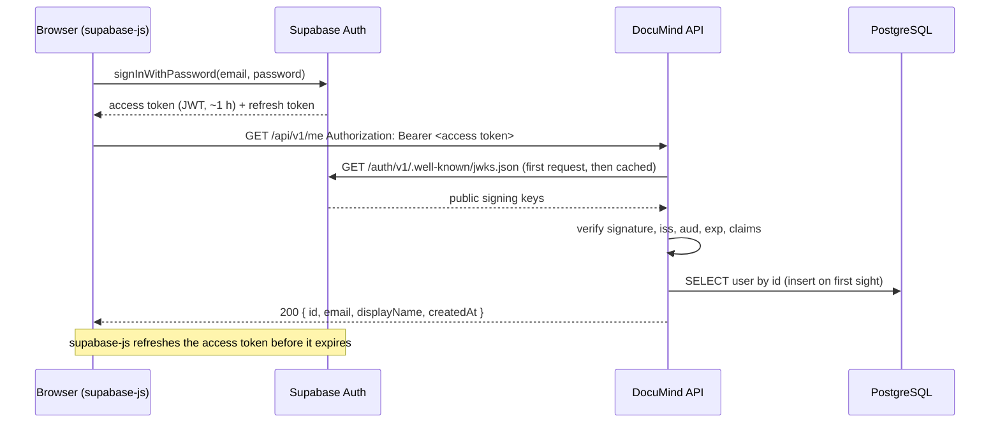

# Authentication and authorization

How DocuMind establishes who a caller is and what they may access. The decision record is
[ADR-013](../adr/013-supabase-auth-bearer-jwks.md).

## Overview

Identity is delegated to **Supabase Auth**. The browser signs in with Supabase directly
(supabase-js) and calls the DocuMind API with the short-lived access token as a bearer token. The
API never sees passwords and holds no token-signing secret: it verifies each token's signature
against Supabase's **public** keys (JWKS).

## Token verification (API)

`AccessTokenVerifier` (`apps/api/src/auth/access-token-verifier.ts`) accepts a token only if all of
these hold:

| Check                                       | Rejects                                               |
| ------------------------------------------- | ----------------------------------------------------- |
| Length ≤ 8 KB                               | Oversized input before any parsing                    |
| `alg` is `ES256` or `RS256`                 | `none`, HS256 (algorithm confusion), other algorithms |
| Signature matches a key in the project JWKS | Forged or altered tokens, keys from other projects    |
| `iss` = `<SUPABASE_URL>/auth/v1`            | Tokens from another Supabase project                  |
| `aud` = `authenticated`                     | Anonymous-key (`anon`) tokens                         |
| `exp` present and not past (5 s tolerance)  | Expired tokens; `nbf` in the future                   |
| `sub` is a UUID, `iat` present              | Malformed tokens                                      |
| `role` = `authenticated`                    | `service_role` and `anon` keys used as user tokens    |
| `is_anonymous` is not `true`                | Supabase anonymous sign-ins                           |
| `email` present (3–320 characters)          | Phone-only accounts (not supported)                   |

Keys come from `createRemoteJWKSet`. They are cached in memory for 10 minutes; a token with an
unknown key id triggers a refetch, at most once per 30 seconds, so Supabase key rotation needs no
restart. A fetch times out after 5 seconds.

### Status codes

| Situation                                      | Response | `WWW-Authenticate`                               |
| ---------------------------------------------- | -------- | ------------------------------------------------ |
| No `Authorization: Bearer …` header            | 401      | `Bearer realm="documind"`                        |
| Token fails any check                          | 401      | `Bearer realm="documind", error="invalid_token"` |
| Token expired                                  | 401      | as above; message `Access token expired`         |
| Signing keys cannot be fetched (Supabase down) | 503      | none                                             |

The 401/503 split matters: a 401 tells the web client the session is unusable and leads to
sign-out, so a Supabase outage must not look like a bad token. The 503 cause is logged; the token
is never logged.

## Secure by default

`AuthGuard` is registered globally (`APP_GUARD`) in the API process. **Every route requires a valid
token unless it is explicitly marked `@Public()`**. Today only the health probes are public. A
forgotten decorator therefore fails closed (401), never open.

The worker process does not load the auth module: it has no HTTP surface and acts as the system.

## User provisioning

The `users` table is DocuMind's copy of Supabase identities, keyed by the Supabase user id (`sub`).
On each authenticated request `UserProvisioningService`:

1. reads the user by primary key (the common case ends here, with no write);
2. if absent, inserts it with `ON CONFLICT (id) DO NOTHING` and appends a `user.registered` audit
   entry in the same transaction. Concurrent first requests create exactly one row and one entry;
3. if the email or display name in the token differ from the row, updates them.

Email is not unique in `users` (migration `20261029140000`): Supabase keeps emails unique among
live users, but this copy can lag behind an email change or a deleted account, and must not block
a legitimate new user. `display_name` comes from `user_metadata`, which the user can edit, so it is
treated as a display label only and dropped if it does not fit the column.

## Authorization

| Layer       | Rule                                                                                       |
| ----------- | ------------------------------------------------------------------------------------------ |
| Route       | Authenticated unless `@Public()` (global guard)                                            |
| Data access | Every read/delete of a user-owned row filters by owner id **in SQL** (`…ForOwner` methods) |
| Response    | Another user's document and a nonexistent id return the same 404 body                      |
| Input       | Path ids are validated as UUIDs (400); list cursors are validated and opaque               |
| Database    | Row Level Security enabled with no policies: Supabase's Data API exposes nothing           |

Ownership is never checked by loading a row and comparing afterwards: a query that omits the owner
filter cannot be written through the repositories. A forged pagination cursor only moves the start
point within the caller's own documents.

## Web client

- `AuthProvider` subscribes to `onAuthStateChange`, so sign-in, token refresh and sign-out (also
  from other tabs) update the UI immediately.
- `RequireAuth` redirects signed-out users to `/login`, remembering the target path. The return
  path is accepted only if it is an in-app path (`safeRedirectPath`), which prevents open
  redirects such as `//evil.example`.
- The API client sends the current access token. On a 401 it refreshes the session once and
  retries; if that fails it signs out locally and the guard redirects to the login page.
- Sign-in errors use fixed messages; the reset-password page shows the same confirmation whether
  or not the email exists, so neither reveals which emails are registered.
- Password reset uses the PKCE flow: the email link carries a one-time code, not tokens, and works
  only in the browser that requested it.

Route guards are a usability feature. The security boundary is the API.

## Supabase project setup (manual, once)

1. Create a free project. Copy the **Project URL** into `SUPABASE_URL` and `VITE_SUPABASE_URL`, and
   the **publishable key** (or legacy anon key) into `VITE_SUPABASE_PUBLISHABLE_KEY`.
2. **JWT signing keys:** make sure the project signs with an asymmetric key (ECC P-256
   recommended). Projects still on the legacy shared secret must migrate and rotate to the new key
   (Dashboard → Settings → JWT Keys); the API rejects HS256 tokens.
3. **Authentication → Providers → Email:** keep **Confirm email** on.
4. **Authentication → URL Configuration:** set the Site URL to the web app (locally
   `http://localhost:5173`) and add `http://localhost:5173/reset-password` and
   `http://localhost:5173/login` to the redirect allow-list.
5. Optional hardening: minimum password length 8, leaked-password protection, a shorter access
   token lifetime (see limitations).

Automated tests need none of this: they sign tokens with a locally generated key pair.

## Known limitations

- **Access tokens cannot be revoked before they expire.** After sign-out, password change or
  account deletion, an already-issued access token stays valid until `exp` (Supabase default 1
  hour). Mitigation: shorten the token lifetime in Supabase. Checking `session_id` against
  Supabase on every request would close the gap at the cost of a network call per request.
- **Tokens live in `localStorage`** (supabase-js default), so an XSS bug could steal a session. A
  strict Content-Security-Policy for the web app is required at deployment (Phase 16). React
  escapes rendered values and the app renders no server-provided HTML.
- **No API rate limiting yet.** Supabase rate-limits sign-in and sign-up; DocuMind's own endpoints
  are unthrottled until a later phase.
- **No account deletion flow.** Deleting a user in Supabase leaves their DocuMind row and documents
  in place; a deletion flow must remove stored files, then the rows (Phase 4 onward).
- **MFA is not enforced** (`aal` is not checked).
- Signed-out pages are functional but unstyled beyond basics; Phase 3 applies the design system.
